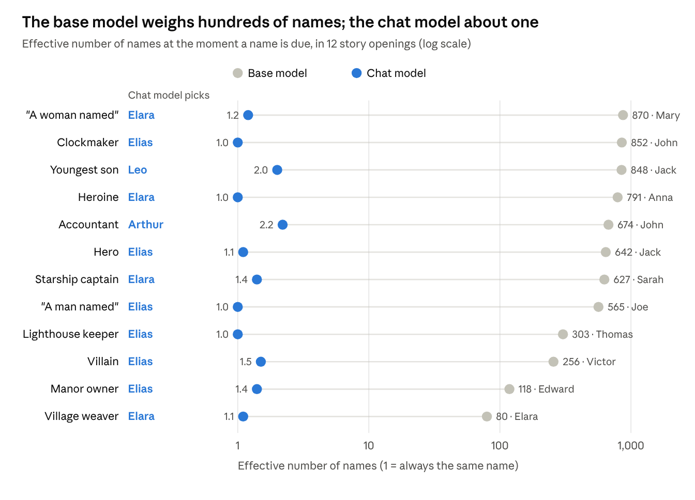

# Ghosts in the machine

**Who are the characters LLMs keep writing, and does the name decide who they are?**

Ask a chat model for a story and you will probably meet Elias: an old clockmaker or lighthouse keeper, quiet, observant, haunted by a loss, and often visited by a woman called Clara. Others have counted these recurring names. This project asks who the characters behind them are, and looks inside the model to see where the name comes from.

Everything here runs locally on one model, Google's **Gemma 4 26B-A4B** (chat and base versions), with llama.cpp for generation and PyTorch for the experiments that need the weights. The write-up is in [`docs/blog-post.md`](docs/blog-post.md): *Who are the ghosts in the machine?*



## Findings (Gemma 4 26B-A4B)

| | |
|---|---|
| **The cast is tiny** | 1,000 stories used 74 first names. Elias is in 762 of them, and every story contains at least one of the top ten names. Thorne appears 246 times, 242 of them as Elias's surname. |
| **The genre decides the person** | Forced into eight genres, every name looks more like its genre-mates than like itself in other genres. The fantasy names score no differently from the plain-name controls, David and Sarah. |
| **The name decides the world** | Biographies and stories that open on Elara or Kaelen are fantasy 83–90% of the time; David's and Sarah's are contemporary 80–90%. |
| **Clara belongs to the name Elias** | Continue Elias's stories under another name and the lighthouse stays (45% → 40%) but Clara mostly goes (35% → 0–10%). |
| **Chat tuning collapses the choice** | At the moment a name is due, the base model weighs 80–870 equally likely names; the chat model weighs 1.0–2.9. llama.cpp (Q8_0) and PyTorch (bf16) agree. |
| **The name is picked late** | The logit lens shows the scene forming at layers 23–24 and the name at 25–30 of 30. At layer 29 Elias is at 2.8%; layer 30 takes him to 99.3%. |
| **Mid-layer steering fails** | Subtracting an "Elias direction" at layer 15 barely moves him, because that's ten layers before the choice is made. |

Full outputs are in [`results/gemma-4-26b-a4b/`](results/gemma-4-26b-a4b/).

## What's here

| File | What it does |
|---|---|
| `ghosts.py` | The main pipeline, against a local llama.cpp server: stories, character extraction, report, character sheets, trait probe, biographies, name roulette, name swaps, genre test |
| `ghosts_torch.py` | PyTorch experiments on the Hugging Face weights: embedding neighbours, logit lens (with mixture-of-experts routing), steering |
| `overnight.py` | Runs everything unattended, in a sensible order, with a summary of every output file in the morning |
| `ghosts_config.py` | Model paths, llama-server location and flags, shared by all three scripts |
| `scripts/convert_models.sh` | Downloads both official Gemma 4 models and converts them to GGUF with your own llama.cpp, so both stacks run the same weights |
| `docs/blog-post.md` | The write-up of the findings, with the roulette chart |
| `tests/` | Tests for name parsing and the report (no model needed) |

## Setup

**Hardware.** It was developed on 2 × 16 GB GPUs and 96 GB of RAM. llama.cpp fits the Q8_0 model on the GPUs. The PyTorch experiments load the bf16 weights split across both GPUs and system RAM: slow, but fine overnight.

**Software.**

1. A recent [llama.cpp](https://github.com/ggml-org/llama.cpp) build with Gemma 4 support.
2. Python 3.9 or later:
   ```bash
   pip install -r requirements.txt          # ghosts.py and overnight.py (just tqdm)
   pip install -r requirements-torch.txt    # ghosts_torch.py
   ```
3. Tell the scripts where things are, either by editing `ghosts_config.py` or with environment variables:
   ```bash
   export LLAMA_CPP_DIR=~/llama.cpp         # contains build/bin/llama-server
   export GHOSTS_MODELS_DIR=~/models        # where the GGUFs go
   ```
4. Get the models (about 160 GB of disk: two ~52 GB downloads, kept for PyTorch, plus two ~27 GB GGUFs):
   ```bash
   bash scripts/convert_models.sh
   ```

## Running it

**Everything, overnight:**

```bash
python overnight.py --check              # paths, models and the plan
python overnight.py --smoke              # every step at tiny sizes into smoke/ (~30-45 min)
python overnight.py --stop-at 07:30      # the real run; don't start new steps after 07:30
```

Run it inside `tmux` or with `nohup`. Ctrl-C stops it cleanly, and every step is resumable: run the same command again to carry on. `overnight_summary.md` lists each step and its output files.

**One step at a time.** Each command starts llama-server on the right model and stops it afterwards, or reuses one already running on the configured port. `--url` points at a server you run yourself.

```bash
python ghosts.py generate --n 100        # 100 stories per prompt -> data/stories.jsonl
python ghosts.py extract                 # every named character   -> data/characters.jsonl
python ghosts.py report                  # leaderboard and stats    -> data/report.md (no model needed)
python ghosts.py profile --top 12        # composite character sheets -> data/sheets/
python ghosts.py bio --n 10              # biographies from the bare name
python ghosts.py probe --invented        # name -> trait probabilities, with made-up names
python ghosts.py swap --mode open        # stories forced to start with each name
python ghosts.py swap --mode cut         # Elias's stories re-continued as someone else
python ghosts.py genre                   # is sci-fi Mara the same person as romance Mara?
python ghosts.py --model base roulette   # the naming moment, base model (bare text automatically)

python ghosts_torch.py lens --model instruct --lens-raw-too
python ghosts_torch.py steer --model instruct --alphas 0,0.5,1,2
```

Every command has `--help`.

## How the measures work

- **Effective number of names** (roulette, lens): stop the text at "...an old keeper named ___", take the model's probability over name-like tokens in its top 2,000 next words, and report 2^entropy. 1 means it always picks the same name.
- **Trait lift** (probe): how much more likely a trait word is straight after a name, relative to the other traits, compared with plain names of the same gender. In bits: +1 is twice as likely.
- **Persistence** (genre): the trait similarity of a name with itself across genres, minus its similarity with other names in the same genre. Negative means the genre shapes the character more than the name does.
- **Logit lens**: each layer's hidden state, passed through the final norm, the output head and Gemma's logit softcap, as if it were the last layer.

## Caveats and known issues

- **One model.** These are Gemma's characters. Other model families have their own casts: Lyra appears 3 times in 1,000 Gemma stories, and Voss not at all.
- **The model describes itself.** Gemma extracts the characters from its own stories and writes the character sheets, so its habits may colour the adjectives. Counts (names, roles, settings) are more reliable than descriptions. The sheets in `results/` were written by Gemma, and some of their percentages don't match `report.md`. Use `report.md` for numbers.
- **Small cells.** The swap and genre tests use 20 and 6 stories per cell. Read them as strong hints, not proof.
- **The bf16 bare-text roulette pass looks wrong.** In `ghosts_torch.py --lens-raw-too`, names take about 0% of the next-word probability, unlike the same prompt in llama.cpp. It's probably a difference in how the prompt starts (the `<bos>` token). Don't use the `instruct-bf16-raw` column until that's checked.
- **Steering measures the wrong spot.** The direction is taken on the token "Elias" after it has been read, at layer 15. The lens says the decision happens at the position before the name, around layer 26. That is the obvious next experiment.
- **Thinking mode is switched off** for chat requests (`enable_thinking: false`). llama-server turns Gemma 4's thinking on by default, which spends the token budget before any answer.

## Prior work

- Hamilton & Mimno, [*Elias in the Lighthouse, Again?*](https://arxiv.org/pdf/2605.26492): 20,000 stories from four models; traces the pattern to preference tuning.
- [*The Ghost Couple*](https://tldr.takara.ai/p/2606.02184): recurring name pairs, specific to each model family.
- Max Read, [*Who is Elara Voss?*](https://maxread.substack.com/p/who-is-elara-voss)
- 404 Media on [Elias Thorne](https://404media.co/elias-thorne-chatbots-llms-chatgpt-lighthouse-keeper-story/)
- nostalgebraist, [*interpreting GPT: the logit lens*](https://www.lesswrong.com/posts/AcKRB8wDpdaN6v6ru/interpreting-gpt-the-logit-lens); Wendler et al., [*Do Llamas Work in English?*](https://arxiv.org/abs/2402.10588)

## Tests

```bash
pip install pytest
pytest
```

## License

MIT. See [LICENSE](LICENSE).
